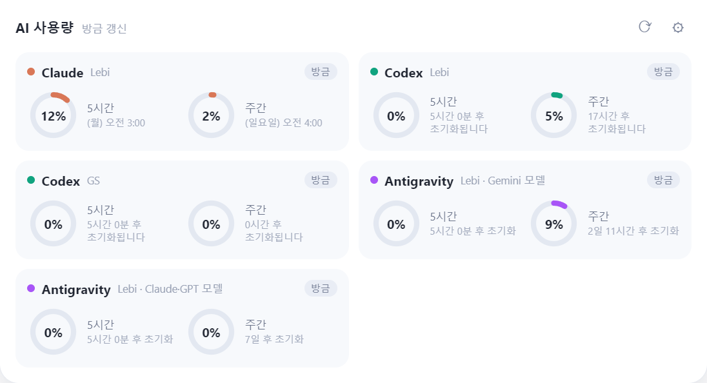

# AI 사용량 (AI Usage Dock)

Claude · Codex · Antigravity 같은 AI 서비스의 **5시간 · 주간 사용량**을 한눈에 보여주는 Windows 데스크톱 위젯입니다.
평소엔 숨어 있다가, 화면 맨 위 가운데나 작업표시줄 시계에 마우스를 대면 독(Dock)처럼 나타납니다.

[](https://github.com/cybereun/ai-usage-dock/releases)
[](https://github.com/cybereun/ai-usage-dock/releases)
[](https://github.com/cybereun/ai-usage-dock/releases)
[](https://www.electronjs.org/)
[](https://nodejs.org/)
[](https://github.com/cybereun/ai-usage-dock/commits/main)
[](https://github.com/cybereun/ai-usage-dock)
[](https://github.com/cybereun/ai-usage-dock/graphs/commit-activity)

<p align="center"></p>

## 주요 특징

- **독처럼 나타나는 위젯** — 화면 맨 위 가운데 또는 작업표시줄 시계(오른쪽 아래)에 마우스를 대면 슬라이드로 나타나고, 마우스가 떠나면 자동으로 접힙니다.
- **여러 계정 동시 표시** — 같은 AI라도 계정이 3개면 3개 모두 카드로 보여줍니다. 계정마다 로그인이 따로 저장됩니다.
- **원형 게이지** — 5시간 / 주간 사용량을 게이지로 표시하고, 60% 이상 주황, 80% 이상 빨강으로 경고합니다. 초기화까지 남은 시간도 함께 보여줍니다.
- **자동 갱신** — 기본 10분마다 갱신합니다(설정에서 변경). 위젯을 열 때 오래된 값이면 바로 새로 읽습니다.
- **밝고 미니멀한 UI** — 흰 카드 중심의 깔끔한 디자인.
- **새 버전 알림** — 새 릴리즈가 나오면 위젯과 설정 창에 알려 줍니다.
- **수동 입력 지원** — 사용량 화면이 없는 서비스(Gemini, Grok 등)는 5시간·주간 %를 직접 입력할 수 있습니다.
- **가볍게 동작** — 별도 서버 없이 내 PC에서만 동작합니다.

### 지원 서비스

| 서비스 | 읽는 방식 | 비고 |
| --- | --- | --- |
| Claude | 자동 (Chrome 로그인) | 사용량 설정 화면을 읽음 |
| Codex (ChatGPT) | 자동 (Chrome 로그인) | `chatgpt.com/codex/cloud/settings/usage` |
| Antigravity | 자동 (`agy` CLI) | Gemini 모델 / Claude·GPT 모델 2개 카드 |
| Gemini · Grok · 기타 | 수동 입력 | 사용량 화면 주소를 알면 자동 읽기로 전환 가능 |

## 설치

[Releases](https://github.com/cybereun/ai-usage-dock/releases) 에서 받습니다.

- **`AI-Usage-Dock-Setup-v*.exe`** — 설치용. 더블클릭하면 설치 후 바탕화면 · 시작 메뉴에 바로가기가 만들어집니다.
- **`AI-Usage-Dock-v*-win-x64.zip`** — 휴대용. 압축을 풀고 `AI 사용량.exe` 를 실행합니다.

> 계정 읽기에는 **Chrome 또는 Edge** 가 필요합니다.

## 사용법

1. 앱을 실행하면 설정 창이 열립니다. **＋ 계정 추가**에서 서비스를 고르고 별명을 입력해 추가합니다.
2. **Claude / Codex**: 계정 옆 **[로그인]** 을 누르면 Chrome 창이 열립니다. 로그인하면 사용량을 읽고 **창이 자동으로 닫힙니다.** (구글 로그인도 가능)
3. **Antigravity**: 추가하면 `agy /usage` 로 자동으로 읽습니다. (`agy` CLI 가 설치·로그인되어 있어야 함)
4. **Gemini · Grok 등**: 수동 입력 칸에 5시간 / 주간 % 를 적습니다.
5. 화면 맨 위 가운데, 또는 작업표시줄 시계에 마우스를 대면 위젯이 나타납니다.

| 동작 | 방법 |
| --- | --- |
| 위젯 바로 보기 | `Ctrl + Alt + U` 또는 트레이 아이콘 클릭 |
| 설정 열기 | 위젯의 ⚙ 버튼, 트레이 아이콘 더블클릭 |
| 새로고침 | 위젯의 ⟳ 버튼 |
| 로그인 다시 하기 | 카드의 "로그인 필요" 표시를 클릭 |

설정에서 위/시계 트리거 켜기·끄기, 자동 갱신 주기, 윈도우 시작 시 자동 실행을 바꿀 수 있습니다.

### 알아두면 좋은 점

- 사용량은 서비스 화면의 글자를 읽는 방식이라, 서비스가 화면을 바꾸면 읽지 못할 수 있습니다. 그때는 수동 입력으로 바꿔 쓰세요.
- 갱신할 때 Chrome 창이 화면 밖에 잠깐 떴다 사라집니다.
- 다른 PC에서는 계정마다 로그인을 한 번 다시 해야 합니다.

## 개발

```bash
git clone https://github.com/cybereun/ai-usage-dock.git
cd ai-usage-dock
npm install --save-dev electron@33
npx electron .
```

```
src/
├─ main.js        # 메인 프로세스: 트리거 감지, 사용량 읽기(Chrome CDP / agy), 트레이, IPC
├─ preload.js     # 렌더러 ↔ 메인 브리지
├─ widget.html    # 독 위젯 UI
├─ settings.html  # 설정 · 계정 관리 UI
└─ icon.png/.ico  # 앱 아이콘
tools/make-icon.ps1   # 아이콘 생성 + exe 아이콘 교체
```

## 릴리즈 히스토리

### v1.0.3 — 2026-10-17
- 새 버전 알림 추가 (하루 2번 GitHub 릴리즈 확인, 위젯·설정 창에 안내)
- 모니터 배율이 달라도 독 창이 틀어지지 않도록 수정 (멀티 모니터)
- 설치 프로그램 폴더 풀기 오류 수정

### v1.0.2 — 2026-10-17
- Antigravity 새 모델 그룹(예: Gemini 4 Argon)을 CLI 에서 감지해 카드를 자동 추가
- 5시간 한도가 없는 그룹(주간 한도만 있는 모델)을 올바르게 표시

### v1.0.1 — 2026-10-12
- 독이 오래 켜 둔 뒤 나타나지 않던 문제 수정 (자동 복구 감시 추가, 절전·모니터 변경 후에도 유지)
- 사용량을 읽을 때 Chrome 창이 작업표시줄에 깜빡이던 문제 개선 (창을 숨겨서 읽음)
- 기본 갱신 주기 3분 → 10분
- 다른 PC 설치 안정성 개선 (쓰기 불가 폴더 대비)

### v1.0.0 — 2026-10-11
- 첫 정식 릴리즈
- 화면 상단 가운데 / 작업표시줄 시계 호버로 나타나는 독 위젯
- Claude · Codex 자동 읽기 (Chrome 로그인, 로그인 완료 시 창 자동 닫힘)
- Antigravity `agy /usage` 자동 읽기 (Gemini / Claude·GPT 모델 2개 카드)
- Gemini · Grok · 기타 수동 입력, 같은 서비스 다중 계정
- 밝고 미니멀한 UI, 원형 게이지, 사용량 경고 색상
- 설치용 단일 exe 및 휴대용 zip 제공

## 개발자

**Lebi_cybereun** — [github.com/cybereun](https://github.com/cybereun)
